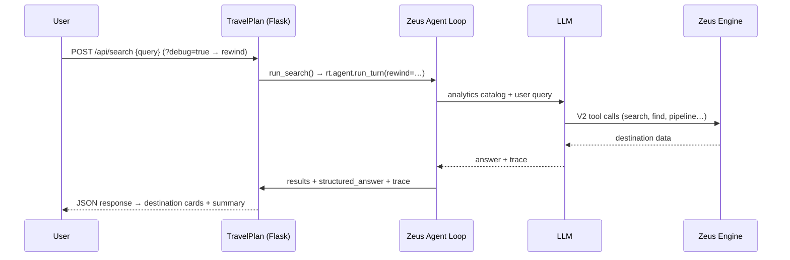

# TravelPlan

A demo travel search app that combines natural-language queries with the [Zeus Engine](https://github.com/koten-ai) and an LLM agent loop. Describe where you want to go in plain English and get destination recommendations backed by real Zeus `travel-sample` data.

Built with **Flask**, **Tailwind CSS**, and **DaisyUI** on the frontend, using [`kotenai-zeus-client` **2.5.4**](https://github.com/koten-ai/zeus_client_python) from the sibling `../zeus_client_python` repo for the Zeus agent loop (boot gate: 2.5.x family, ZCP-113 hub-join-v1).

**Reference demo** for the [Demo Builder Kit](../zeus_client_python/docs/demo-builder/) (build similar apps from docs). GitBook: site section **Demo** → Python.

## Features

- **Natural-language search** — Ask for destinations by vibe, budget, region, or activity (e.g. *"warm beaches in Europe under $2000"*).
- **LLM + Zeus agent loop** — An LLM orchestrates Zeus V2 verbs (`search`, `find`, `pipeline`, etc.) against the `travel-sample._default` scope.
- **Destination cards** — Results are extracted from Zeus tool traces, with a markdown answer parser as fallback when the model returns prose instead of structured rows.
- **Zeus trace panel** — CDN **zeus_client_chat_trace `latest`** inspector. Open the app with `?debug=true` and use the lightning toggle (bottom-left). That same query also opts the search turn into Zeus rewind (`?rewind=true` on verbs; JSON `"rewind": true` on session hops). Hub Analysis Prompt **sent** tiles need `?debug=true` + durable sessions + the 2.5.4 client pin.
- **Multi-provider LLM support** — Configure xAI Grok or OpenAI (extensible via `config.json`).
- **Docker-ready** — One-command deployment with hot-reload volumes for local development.

## How It Works



1. The user submits travel preferences through the search UI.
2. Flask calls `run_search()`, which loads the catalog and runs `rt.agent.run_turn()` in `analytics` mode.
3. The LLM decides which Zeus tools to call and synthesizes a natural-language answer.
4. The BFF maps `TurnResult` into destination cards (`results[]`); if hops are empty, `answer_parser` parses the markdown answer into structured JSON.
5. The frontend renders cards and appends the trace to the debug panel.

## Prerequisites

- **Zeus Engine** running and reachable, with the `travel-sample._default` scope loaded
- **LLM API key** — xAI Grok (default) or OpenAI
- **Docker** (recommended) or **Python 3.11+**

## Quick Start

### Docker (recommended)

```bash
# 1. Create .env from the example
cp .env.example .env

# 2. Edit .env — set LLM_API_KEY and ZEUS_PASSWORD
#    Leave config.json secret-free (api_key_env / scope password_env are names only).

# 3. Start the app
docker compose up --build
```

Open [http://localhost:5050](http://localhost:5050) (host **5050** → container 5000). Tracer: [http://localhost:5050/?debug=true](http://localhost:5050/?debug=true).

Docker sets `ZEUS_URL` to `http://host.docker.internal:8080` so the container can reach Zeus on the host. That value wins over `.env`. The image copies secret-free `config.json`; Compose bind-mounts `./.env` read-only (`./.env:/app/.env:ro`). Restart the container after you change `.env`. Do not put the API key in `config.json`.

### Local development

```bash
# zeus_client_python must live at ../zeus_client_python (monorepo layout)
cp .env.example .env
# Edit .env — set LLM_API_KEY and ZEUS_PASSWORD

pip install -e ".[dev]"
python -m travel_planner
```

The server listens on port `5000` by default. Set `ENVIRONMENT=dev` to enable Flask debug mode. Tracer: [http://localhost:5000/?debug=true](http://localhost:5000/?debug=true).

## Configuration

`config.json` is committed and secret-free. Copy `.env.example` to `.env`, then set `LLM_API_KEY` and `ZEUS_PASSWORD`. `config.json` stores the env **names** `llm.api_key_env` (`LLM_API_KEY`) and `scope_credentials.*.password_env` (`ZEUS_PASSWORD`). Basic auth reads that scope entry. A non-empty env var overrides the file value for URL, auth mode, username, bucket, scope, collection, mode, base URL, and model. Do not put the API key in `config.json`.

| Setting | Description |
|---------|-------------|
| `zeus.url` | Zeus Engine base URL when `ZEUS_URL` is unset |
| `zeus.scope_credentials` | Basic-auth user and `password_env` for `bucket/scope` (`demo_1`, `ZEUS_PASSWORD`) |
| `zeus.auth_mode` | `basic`, unless `ZEUS_AUTH_MODE` is set |
| `llm.api_key_env` | Env var **name** for the LLM key (`LLM_API_KEY`). The key stays in `.env` |
| `llm.base_url` / `llm.model` | `https://api.x.ai/v1` and `grok-4-1-fast-non-reasoning`, unless `LLM_BASE_URL` / `LLM_MODEL` are set |
| `settings.mode` | `analytics`, unless `ZEUS_MODE` is set |
| `target` | `travel-sample` / `_default` / `_default` |
| `client_floor` | Must be `client-floor-6.1` for Zeus 0.7.x (`base-6.1`). Floor-5 fails closed and the agent runs with no Zeus verbs. |
| `settings.durable_sessions` | Durable Zeus sessions (default **true**) |
| `settings.ai_process_result` | Extra insight hop after tools (default **false**) |
| `session.semantic_cache.enabled` | Semantic agent memory (default **false**; Zeus ≥ 0.7.6 to turn on) |

### Environment variables

Copy `.env.example`. Compose `ZEUS_URL` overrides the file. `python-dotenv` does not expand `$` in values.

| Variable | Default | Description |
|----------|---------|-------------|
| `ZEUS_URL` | `http://localhost:8080` | Zeus public API. Compose sets `http://host.docker.internal:8080` |
| `ZEUS_BUCKET` | `travel-sample` | Bucket. Overrides `target.bucket` when set |
| `ZEUS_SCOPE` | `_default` | Scope. Overrides `target.scope` when set |
| `ZEUS_COLLECTION` | `_default` | Collection. Overrides `target.collection` when set |
| `ZEUS_MODE` | `analytics` | Agent mode. Overrides `settings.mode` when set |
| `ZEUS_AUTH_MODE` | `basic` | Auth mode. Overrides `zeus.auth_mode` when set |
| `ZEUS_USERNAME` | `demo_1` | Basic-auth user. Overrides the active scope credential when set |
| `ZEUS_PASSWORD` | empty | Basic-auth password. Set in `.env` only |
| `LLM_API_KEY` | empty | **Required** LLM key. Set in `.env`, not in `config.json` |
| `LLM_BASE_URL` | `https://api.x.ai/v1` | Provider base URL |
| `LLM_MODEL` | `grok-4-1-fast-non-reasoning` | Model for that base URL |
| `HOST` | `0.0.0.0` | Listen host for `python -m travel_planner` |
| `PORT` | `5000` | HTTP listen port (Compose publishes host **5050**) |
| `ZEUS_CLIENT_CONFIG_DIR` | project root | Directory containing `config.json` |
| `ZEUS_CHAT_REQUESTS_DIR` | `data/chat_requests` | Local chat_request catalog snapshots |
| `ZEUS_CLIENT_FLOOR` | `client-floor-6.1` | Overrides `client_floor` from config |
| `CHAT_LOG_PATH` | `data/chats.jsonl` | Chat persistence file |
| `ENVIRONMENT` | — | Set to `dev` for Flask debug mode |

## API

### `POST /api/search`

Search for destinations matching natural-language preferences.

```bash
curl -X POST 'http://localhost:5000/api/search?debug=true' \
  -H "Content-Type: application/json" \
  -d '{"query": "tropical destinations with great food"}'
```

Query `debug=true` (same as `/?debug=true`) sets `rewind=true` on that Zeus turn. Omit it for a normal search.

**Request body:**

```json
{
  "query": "warm beaches in Europe under $2000",
  "chat_id": "optional-existing-chat-id"
}
```

**Response** (abbreviated):

```json
{
  "chat_id": "travel_abc123",
  "query": "warm beaches in Europe under $2000",
  "answer": "Here are some great options…",
  "structured_answer": { "destinations": […] },
  "results": [
    { "name": "Santorini", "description": "…", "image": "…" }
  ],
  "trace": { "tool_calls": […] },
  "model": "grok-4-1-fast-non-reasoning",
  "provider": "grok",
  "rewind": true
}
```

### `GET /api/tool-order`

Returns the Zeus tool invocation order for V1 and V2 API versions (used by the trace panel).

### `GET /api/health`

Process health: app version, installed `kotenai-zeus-client` version (currently **2.5.4**, must start with `2.5`), and `client_import` (`zeus_client`).

### `GET /`

Serves the TravelPlan search UI.

## Project Structure

```
demo_travel_sample/
├── src/travel_planner/       # Application package
│   ├── app.py                # Flask routes and app factory
│   ├── search.py             # Domain wrapper around ZeusRuntime.agent.run_turn
│   ├── runtime_factory.py    # config.json + env overrides → ZeusRuntime + ports
│   ├── turn_mapper.py        # TurnResult → /api/search JSON
│   ├── results_parser.py     # Extract destination cards from Zeus traces
│   ├── answer_parser.py      # Markdown answer → structured JSON fallback
│   ├── async_runner.py       # Background loop + process-scoped ZeusRuntime
│   ├── chat_store.py         # Multi-turn chat persistence (JSONL)
│   ├── tool_order.py         # Trace panel tool-order axes
│   ├── zeus_config.py        # Path/env configuration before runtime bind
│   ├── templates/            # Jinja2 HTML (index.html)
│   └── static/               # CSS, JS (trace widget is CDN latest, not vendored)
├── data/
│   └── chat_requests/        # vendored analytics base-6.1 pin + _default load path
├── tests/                    # Pytest suite
├── .env.example              # Copy to .env; set LLM_API_KEY and ZEUS_PASSWORD
├── config.json               # Secret-free runtime document
├── docker-compose.yml
├── Dockerfile
└── pyproject.toml
```

## Development

### Tracer widget (CDN latest)

TravelPlan loads `zeus_client_chat_trace` from the public CDN **`latest`** pointer (not a vendored `/static/` copy):

```text
https://koten-static-cdn.nyc3.cdn.digitaloceanspaces.com/zeus_client_chat_trace/latest/zeus_client_chat_trace.js
```

Publish a new inspector from the sibling repo (`npm test && npm run build && npm run publish:cdn`). To freeze a release, point `templates/index.html` at `…/zeus_client_chat_trace/<semver>/zeus_client_chat_trace.js`. See `.grok/guides/CDN_TRACE_WIDGET.md`.

### Run tests

```bash
pip install -e ".[dev]"
pytest
```

With coverage:

```bash
pytest --cov=travel_planner --cov-report=term-missing
```

Integration tests that require a live Zeus or LLM service are marked with `@pytest.mark.integration`.

### CLI entry point

After installing the package, you can also run:

```bash
travel-planner
```

## Troubleshooting

| Symptom | Likely cause | Fix |
|---------|--------------|-----|
| `no Zeus URL configured` | `ZEUS_URL` unset and `zeus.url` empty | Set `ZEUS_URL` in `.env` (copy `.env.example`) |
| LLM calls fail / missing API key | `LLM_API_KEY` unset | Set `LLM_API_KEY` in `.env`. Do not put the key in `config.json` |
| Agent answers without Zeus tools | Catalog floor too low or missing pin | Set `client_floor` to `client-floor-6.1`. Vendored pin: `data/chat_requests/chat_request_analytics_base-6.1.json` (load path `travel-sample__default/chat_request_analytics_v2.json`) |
| Empty destination cards | LLM returned prose only | Check `structured_answer` in the API response |
| Docker can't reach Zeus | Wrong network URL | Set `zeus.url` / `ZEUS_URL` to a host-accessible address (e.g. `http://host.docker.internal:8080`) |
| `kotenai-zeus-client 2.5.x required` | Sibling checkout older than 2.5 (this demo uses **2.5.4**) | Update `../zeus_client_python` and `pip install -e ".[dev]"` |
| `network error` on search | Zeus or LLM unreachable | Verify Zeus is running and API key is valid |

## License

This project is licensed under the [BSD 3-Clause License](LICENSE).